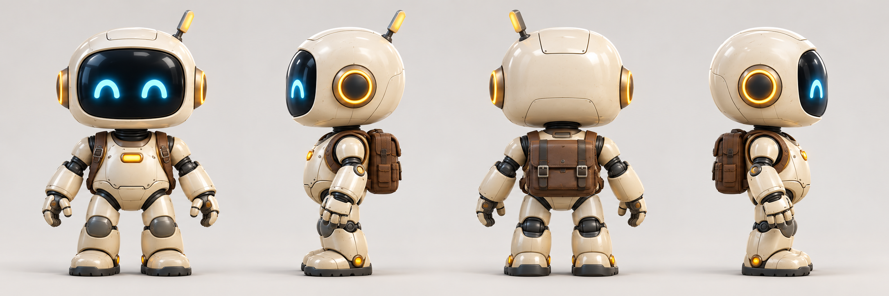
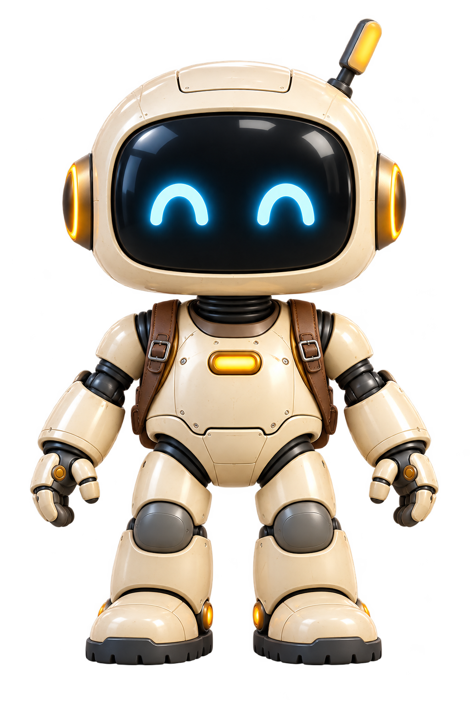
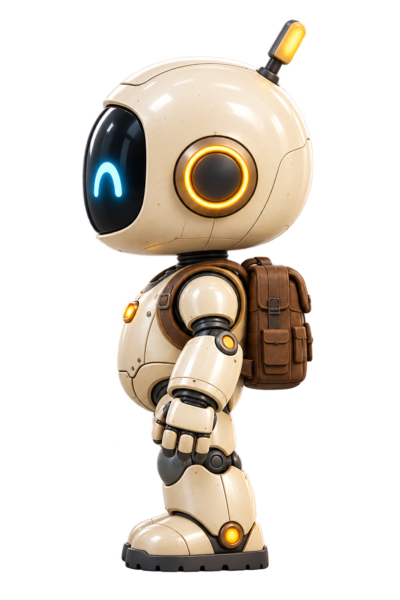
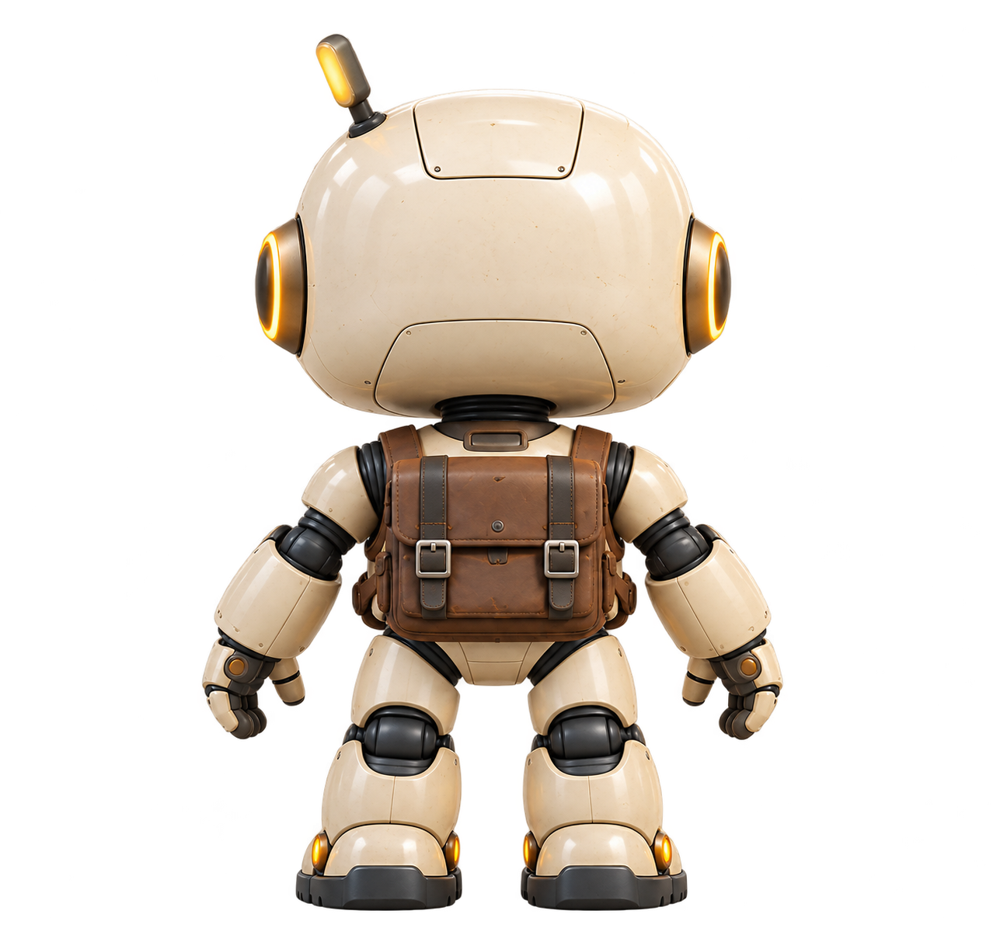
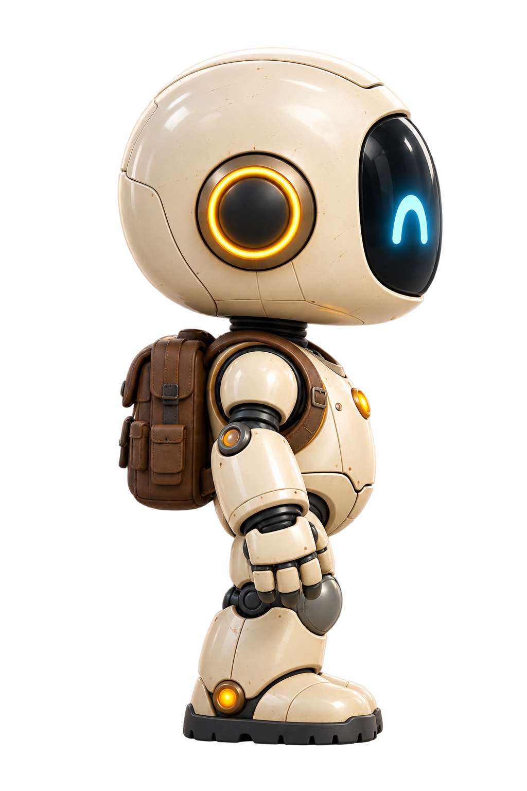
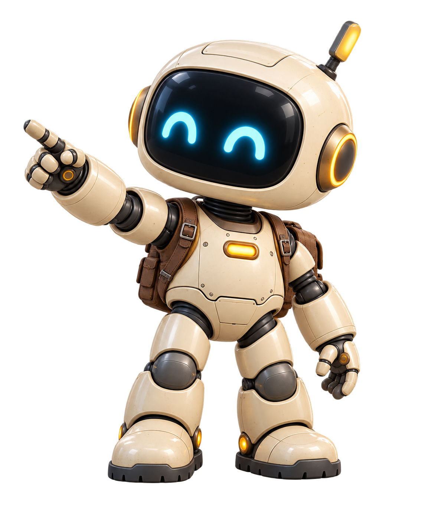

# Робот-проводник Ada Playground

Паспорт маскота · версия 1 · 19 октября 2026

Основной персонаж — **высокий робот, который показывает вперёд**, из шапки Playground. Маленький робот у растения — другой персонаж; его пропорции и поза не входят в этот паспорт. Собственное имя маскоту пока не назначено: «робот-проводник» описывает его роль.

Это визуальный референс для иллюстраций, интерфейса и будущей 3D-модели. Изображения сгенерированы встроенным imagegen; это не скриншоты работающей игры и не готовая 3D-модель.

## Что сохраняем из исходной иллюстрации

Маскот выглядит как небольшой дружелюбный исследователь: большая округлая голова, короткое крепкое тело, светлая оболочка и тёмные подвижные соединения. Его выражение узнаётся по двум светящимся голубым глазам-дугам на едином чёрном экране. Тёплые жёлто-янтарные детали уравновешивают холодное голубое свечение. Коричневый рюкзак делает его путешественником, который готов вместе с пользователем открыть новый мир.

Характерный жест — правой рукой показать путь вперёд, немного вверх. Это приглашение попробовать, поиграть или создать что-то своё. Он любопытный, внимательный и уверенный, но не командует пользователем и не изображает всезнающего наставника.

В исходной шапке ступни частично закрыты травой, а спина не видна. **Подошвы, задние панели головы, конструкция рюкзака и его застёжки уточнены на модельном листе v1.** Для последующих изображений используем именно этот лист, а не достраиваем невидимые детали заново в каждой генерации.

Исходная сцена: [два робота в шапке Playground](Assets/PlaygroundMascot/source-header-v1.png).

## Каноническая внешность

### Силуэт и пропорции

Голова — крупный мягкий объём, похожий на скруглённый шлем или коробку с сильно сглаженными углами. Она немного шире корпуса. Ни острых скул, ни угловатой челюсти, ни острых наплечников. Корпус компактный, с округлой передней панелью и узким тёмным поясом механики у таза.

Пропорции ниже — ориентиры для проверки силуэта, а не размеры CAD-модели. Высота H считается от подошв до верхней точки головы, без антенны.

| Часть | Ориентир |
| --- | --- |
| Голова | Около 40–45% H; узнаваемый большой объём, не маленькая человеческая голова |
| Шея | Короткий тёмный гофрированный переход; не длинная стойка |
| Корпус и таз | Примерно четверть H; корпус чуть уже головы |
| Ноги со ступнями | Около трети H; короткие, устойчивые, без тонких человеческих голеней |
| Ступни | Широкие округлые ботинки с читаемой тёмной подошвой |
| Ладони | Небольшие относительно головы, но достаточно крупные для понятных жестов |
| Антенна | Одна короткая деталь; не меняет основной силуэт головы |

Робот должен казаться способным ходить, исследовать и что-то мастерить. Не превращаем его в младенца, длинноногого гуманоида, тяжёлого боевого меха или мягкую плюшевую игрушку.

### Голова и лицо

Передняя часть головы — **единый большой глянцевый экран почти чёрного цвета**, в форме горизонтального прямоугольника с очень скруглёнными углами. Вокруг экрана остаётся непрерывная светлая рамка корпуса. Экран слегка выпуклый, с мягкими отражениями окружения; он не выглядит плоской наклейкой.

На экране — ровно **два голубых глаза**. Базовая радостная форма каждого глаза — толстая перевёрнутая U-образная дуга, как «∩», с округлыми концами. Между глазами сохраняется тёмное пространство. Светящийся ореол небольшой: форма глаз должна оставаться резкой и читаться в уменьшении.

У базового персонажа нет человеческого носа, зубов, губ, ресниц и отдельного нарисованного рта. Эмоцию передают глаза, наклон головы, руки и положение корпуса. Новые выражения не должны превращать экран в человеческое лицо.

По бокам головы находятся круглые золотистые модули: тёмный центр, объёмный тёплый ободок и тонкое янтарное световое кольцо. Они встроены в шлем и не похожи на отдельные большие наушники. На верхней и задней поверхности головы есть несколько аккуратных стыков панелей.

### Антенна и асимметрия

Антенна **одна**, короткая, уплощённая, с жёлтой светлой вставкой и тёмным основанием. Она установлена **слева сзади на голове самого робота**.

| Ракурс | Как ведёт себя антенна |
| --- | --- |
| Спереди | На правой стороне изображения для зрителя |
| Сзади | На левой стороне изображения для зрителя |
| Профиль, лицо влево | Видна у задней части макушки |
| Профиль, лицо вправо | На дальней стороне головы и может быть полностью скрыта |

«Слева у робота» и «слева на картинке» — разные вещи. Нельзя получать противоположный профиль простым зеркальным отражением: оно перенесёт антенну на неверную сторону.

### Корпус, руки и ноги

Светлая броня состоит из отдельных мягко скруглённых деталей. Плечо и предплечье разделены тёмным шарнирным узлом; запястье подвижное. В соединениях видны графитовые кольца и механика, но без плотного набора проводов, трубок и случайных микродеталей.

На груди находится небольшой горизонтальный янтарный индикатор в скруглённой рамке. Это световой элемент, а не текстовый бейдж. Не добавляем туда случайные буквы, надписи или сгенерированное подобие логотипа Ada.

На каждой кисти — **три пальца и большой палец, всего четыре**. Пальцы сегментированные, с округлыми светлыми внешними деталями и тёмными сочленениями. В указательном жесте выпрямлен указательный палец; остальные согнуты естественно, большой палец различим.

Колени закрыты округлыми серыми чашечками. Голени короткие, светлые, слегка расширяются к ботинкам. У ботинок тёмная толстая подошва с простым протектором и небольшие янтарные элементы у щиколотки. Обе ступни полностью показываем в ракурсных изображениях.

### Рюкзак

На спине — один компактный рюкзак тёплого коричневого цвета, по ширине примерно с корпус. Он сидит высоко и не опускается ниже таза. В v1 у него верхний клапан, две вертикальные тёмные застёжки с металлическими пряжками и небольшие боковые карманы.

Спереди видны две плечевые лямки и их крепления. В профиль рюкзак выступает за линию спины. Сзади он занимает центральную часть корпуса. Это походный аксессуар с мягкими краями, не ракетный двигатель и не второй робот.

## Материалы, палитра и свет

Оболочка напоминает тёплую сатиновую керамику или качественный окрашенный композит. На крупных формах есть мягкие блики. Допустимы редкие мелкие потёртости на кромках, но персонаж остаётся аккуратным: без ржавчины, копоти, боевых повреждений и грязи.

Палитра — ориентир для материалов при нейтральном освещении. Цвет конкретного пикселя на иллюстрации меняется от света, отражений и экспозиции; эти HEX не являются результатом измерения всей поверхности.

| Материал | Целевой тон | Назначение |
| --- | --- | --- |
| Основная оболочка | #E8E5DC | Тёплый слоновый, не чистый белый и не жёлтая броня |
| Экран лица | #091720 | Почти чёрный с холодным оттенком |
| Глаза | #39D9FF | Голубой источник света |
| Золотистые детали | #E8B34B | Кольца и небольшие аппаратные акценты |
| Янтарный свет | #FFC86A | Кольца, грудной индикатор, мелкие световые детали |
| Механические соединения | #30343A | Тёмный графит |
| Рюкзак и лямки | #655144 | Тёплый коричневый |
| Подошвы | #242A30 | Тёмная резина |

Для модельных ракурсов используем мягкий нейтральный студийный свет. Для сцен Playground — холодное голубое окружение и умеренные тёплые источники рядом с роботом. Фиолетовый не заменяет голубые глаза или основной акцент продукта.

Не делаем всю поверхность зеркальным хромом. Не заливаем корпус неоном. Свечение глаз не должно скрывать их форму или засвечивать половину лица.

## Ракурсы и файлы

Все отдельные изображения ниже показывают одного и того же персонажа. Передний и боковые ракурсы — студийные референсы с мягкой полупрозрачной световой подложкой; задний ракурс и указательный жест — изолированные PNG на прозрачном фоне. В галерее используется нейтральная подложка. Модельный лист остаётся главным источником конструкции, если в отдельной генерации расходятся мелкие стыки или блики.

### Спереди

Камера перед роботом. Два глаза одинакового размера, корпус не повёрнут, антенна справа для зрителя. Нейтральная A-поза: руки немного отведены от корпуса, кисти расслаблены.

### Профиль, лицо влево

Чёткий боковой вид: читаются глубина экрана, боковой модуль, антенна и объём рюкзака. Это не поворот в три четверти.

### Сзади

Рюкзак, задние панели головы, затылок, обе ноги и подошвы. Лицевой экран, глаза и грудной индикатор не видны. Антенна слева для зрителя.

### Противоположный профиль, лицо вправо

Противоположная сторона той же конструкции. Антенна остаётся на дальней стороне головы: не переносим её ради симметрии кадра.

### Три четверти: жест проводника

Робот повёрнут немного влево на изображении, правой рукой показывает вперёд и вверх. Обе ноги опираются на землю, поза спокойная и устойчивая. Этот ракурс подходит для приглашения создать игру, начала обучения и подсказок.

[Открыть галерею с увеличением](PlaygroundMascot.html).

## Эмоции и использование в интерфейсе

- **Приветствие:** глаза-дуги, небольшой наклон головы, открытая ладонь или жест проводника.
- **Любопытство:** лёгкий наклон головы и корпуса к объекту, внимание выражено позой.
- **Успех:** более открытая поза, небольшой подъём рук; без вспышек и чрезмерного неона.
- **Ожидание:** спокойная поза, интерес к происходящему; не изображаем ошибку или поломку.
- **Ошибка:** внимательный и сочувствующий персонаж, без паники, красных глаз и обвинительного жеста в сторону пользователя.

В шапке держим робота в стороне от заголовка, оставляя спокойное место под текст. В компактном пустом состоянии уменьшаем окружение и количество мелких деталей, сохраняя силуэт головы и форму глаз. На очень маленьком размере лучше использовать голову, чем пытаться показать весь костюм и рюкзак.

Маскот сопровождает контент и действия. Не превращаем его в постоянный большой оверлей, который закрывает игры, редактор или элементы управления.

## Как генерировать того же робота

### Референсы и порядок работы

1. Приложить [turnaround-v1.png](Assets/PlaygroundMascot/turnaround-v1.png) как основной референс личности и конструкции.
2. Если нужна сцена в духе Playground, дополнительно приложить [source-header-v1.png](Assets/PlaygroundMascot/source-header-v1.png) как референс света и окружения. Уточнить: брать высокого стоящего робота, маленького не включать.
3. Взять основной промпт ниже и добавить один конкретный ракурс, позу, кадрирование и фон.
4. Для отдельного персонажа запросить настоящую прозрачность в инструменте генерации. Текст «transparent» сам по себе не заменяет настройку прозрачного фона.
5. Сначала проверить лицо, силуэт и сторону антенны. При ошибке править только проблемный признак, продолжая прикладывать тот же модельный лист.
6. Сохранять новые варианты отдельными файлами с версией, не перезаписывая v1.

Для текущих материалов использован **встроенный imagegen**, без CLI и без ручной правки пикселей. Одинаковый текстовый промпт без изображения-референса не гарантирует сохранение личности персонажа; один текст не заменяет модельный лист.

### Основной промпт на английском

Английская формулировка фиксирует геометрию и материалы. Изменяем блок VARIABLE SHOT, а блок IDENTITY LOCK оставляем целиком. [Открыть промпт отдельным TXT](Assets/PlaygroundMascot/master.prompt.txt).

~~~text
Use case: identity-preserve.
Asset type: a polished stylized 3D brand mascot illustration for Ada Playground.

REFERENCE PRIORITY
The supplied turnaround-v1.png is the authoritative identity and construction
reference. All four figures on that sheet are views of ONE SAME ROBOT.
If a scene reference is also attached, use it for atmosphere only.
Select the tall standing explorer robot, never the small crouching companion.

IDENTITY LOCK
Render the same friendly compact explorer robot with an oversized rounded
warm-ivory ceramic helmet, slightly wider than its compact torso.
Its head occupies about 42 percent of standing height, excluding the antenna.
The face is one large glossy near-black rounded-rectangular inset visor.
Exactly two luminous cyan eyes, each a thick inverted-U smiling arc with
rounded ends. Keep the eye shapes crisp with restrained bloom.
No human nose, lips, teeth, eyelashes or separate drawn mouth.

Two warm golden circular side modules with dark centers and thin amber
light rings. ONE short flattened paddle antenna with a yellow tip on the
robot's OWN LEFT REAR crown. In front view it appears on viewer-right;
in back view it appears on viewer-left. In the opposite side view it may
be hidden by the head. Never mirror the robot or move the antenna.

A short graphite accordion neck. Rounded cream torso armor with one small
horizontal amber status lamp high at the center of the chest.
Dark graphite joint gaps, rounded cream shoulder and forearm armor,
gray rounded knee caps, short sturdy legs, broad cream boots with dark
rubber soles and small amber ankle details.
Each hand has exactly four digits: three fingers and one thumb.

One compact cocoa-brown explorer backpack, two dark brown shoulder straps,
a top flap and two dark fastening straps with metal buckles.
From the front, show the shoulder straps, not the rear backpack face.
From behind, do not show the visor, eyes or front chest lamp.

MATERIAL AND RENDER
High-quality stylized 3D game art with tactile satin ivory ceramic,
warm metal hardware, dark rubber and restrained subtle edge wear.
Clean and cared for, not a battle-damaged robot.
Soft readable lighting, controlled reflections, moderate contrast.
Preserve the reference silhouette, panel layout, backpack and proportions.

VARIABLE SHOT
[Specify ONE camera angle and ONE pose here.]
[Specify full-body, portrait or scene framing here.]
[Specify transparent background or a particular environment here.]

COMPOSITION
Keep the antenna, hands and feet inside the requested framing.
For a full-body reference render, leave roughly ten percent clear margin.
Use an orthographic-like 85 mm product-view perspective for turnarounds.
For a UI header, place the robot to the right and leave calm negative space
for live HTML text on the left. Do not generate text into the illustration.

AVOID
No extra robots, no extra antennae, no mirrored asymmetry, no human face,
no extra fingers, no long thin adult-human limbs, no oversized combat armor,
no guns or weapons, no chrome body, no purple eyes, no neon wash,
no excessive bloom, no random lettering, no invented logo, no watermark.
For transparent output, no painted checkerboard or opaque floor rectangle.
~~~

### Точные промпты для приложенных изображений

Эти файлы содержат полные тексты фактических запросов, а не сокращённые подписи. Для отдельных ракурсов к запросу прикладывался модельный лист v1; для самого листа — исходная шапка.

| Изображение | Полный промпт |
| --- | --- |
| Модельный лист, четыре ракурса | [turnaround.prompt.txt](Assets/PlaygroundMascot/turnaround.prompt.txt) |
| Спереди | [front.prompt.txt](Assets/PlaygroundMascot/front.prompt.txt) |
| Профиль с лицом влево | [profile-left.prompt.txt](Assets/PlaygroundMascot/profile-left.prompt.txt) |
| Сзади | [back.prompt.txt](Assets/PlaygroundMascot/back.prompt.txt) |
| Профиль с лицом вправо | [profile-right.prompt.txt](Assets/PlaygroundMascot/profile-right.prompt.txt) |
| Три четверти, указательный жест | [three-quarter-pointing.prompt.txt](Assets/PlaygroundMascot/three-quarter-pointing.prompt.txt) |

### Примеры заменяемого блока

**Нейтральный фронт:**

~~~text
VIEW: exact front elevation, body square to camera, looking toward the viewer.
POSE: relaxed A-pose, arms slightly away from the torso, both hands relaxed.
FRAMING: full body, antenna and both boots visible, equal clear margin.
BACKGROUND: genuine alpha transparency, no environment or floor plane.
LIGHTING: soft neutral studio lighting.
~~~

**Сцена для шапки Playground:**

~~~text
VIEW: three-quarter front view, gently turned toward image-left.
POSE: the robot's OWN RIGHT hand points diagonally forward and upward,
while the other hand rests naturally. Both feet are planted.
FRAMING: wide panoramic header; robot in the right half.
ENVIRONMENT: a tiny stylized garden on a floating island, quiet blue
atmosphere, subtle warm lights. No second robot.
COMPOSITION: left half is calm dark charcoal negative space for HTML text;
the scene recedes into #121314 at the left and bottom edges.
Keep the face and entire pointing hand clearly visible.
~~~

### Как исправлять расхождения

Не просить «сделай похожего милого робота»: это разрешает модели менять конструкцию. Вместо этого прикладываем канонический лист и называем одно расхождение:

~~~text
Keep the exact same character identity, materials, pose, framing and lighting.
Correct ONLY the antenna: it belongs on the character's own left-rear crown.
Do not mirror the character, add a second antenna or redesign any other part.
~~~

Для лица аналогично просим вернуть ровно две голубые глаза-дуги, не меняя остальное. Для ракурса сзади отдельно запрещаем видимые глаза и грудной индикатор. Для пальцев просим три пальца плюс большой и проверяем обе кисти.

## Проверка нового варианта

- Узнаётся тот же силуэт большой округлой головы и короткого корпуса.
- Экран один; глаза голубые, их два, базовая форма — дуги.
- Нет человеческого носа, зубов, губ или случайного текста на лице.
- Боковые круглые модули золотистые, с тёмным центром.
- Антенна одна и остаётся на собственной левой задней стороне головы.
- Ракурс с другой стороны не сделан зеркальным отражением.
- Руки и ноги соответствуют референсу; пальцы не слились и не размножились.
- Рюкзак коричневый, с двумя плечевыми лямками; не стал двигателем или бронёй.
- Задний вид не показывает лицо и передний грудной индикатор.
- Свечение не съело форму глаз и не выбелило корпус.
- Нет обрезанной антенны, кисти, ботинка или случайного второго персонажа.
- При прозрачном экспорте фон действительно имеет alpha, а не нарисованную шахматную сетку.
- В интерфейсе текст не ложится поверх лица и указательной руки.

## Реестр материалов

[manifest.json](Assets/PlaygroundMascot/manifest.json) хранит названия файлов, размеры, SHA-256, наличие alpha, связи с референсами и инструмент генерации. Исходные PNG сохраняются без ресайза и перерисовки. Модельный лист и точные промпты версионируются вместе с этим документом.
